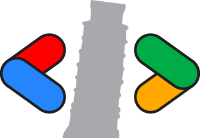

# GDG Pisa &bull; Links

[](https://app.netlify.com/sites/lambent-bunny-988790/deploys)
[](https://astro.build)
[](https://preactjs.com)
[](https://www.typescriptlang.org)

Benvenuto nel progetto GDG Pisa Links! Questo progetto è una semplice web
application che fornisce link alle varie risorse e ai social media di GDG Pisa.
È costruito con TypeScript, Astro e Preact.

## ✨ Funzionalità

- 🎨 Grafica allineata a [gdgpisa.it](https://gdgpisa.it) (font Product Sans,
  colori Google, componenti in stile "sticker")
- 🌓 Design responsive con tema chiaro/scuro: segue il sistema operativo e si
  può cambiare con il pulsante in alto a sinistra
- 🔗 Link ai social media di GDG Pisa
- 📅 Mostra in automatico il prossimo evento GDG Pisa in programma e gli
  eventi successivi ("Coming soon"); quelli passati spariscono da soli
- 💯 Punteggio Lighthouse 100 in tutte le categorie
- 📝 Per aggiornare i link mostrati basta modificare il file `./src/data.yaml`
  (ogni link ha un campo `visible` per nasconderlo senza cancellarlo)
- ⏰ Link visibili solo in un intervallo di date (`dataInizio`/`dataFine`),
  grazie a un rebuild pianificato su Netlify

## 📦 Installazione

Per iniziare, clona il repository e installa le dipendenze (con `npm` o `bun`):

```sh
$ git clone https://github.com/gdgpisa/linktree
$ cd linktree
$ npm install
```

## 🛠️ Sviluppo

### ▶️ Utilizzo

Per avviare il progetto in locale, usa il seguente comando:

```sh
$ npm run dev
```

Questo avvierà un server di sviluppo e potrai vedere l'applicazione nel
browser su `http://localhost:4321`.

### 🏗️ Build del progetto

Per compilare il progetto per la produzione, usa il seguente comando:

```sh
npm run build
```

Questo creerà una cartella `dist/` con la build di produzione
dell'applicazione.

## 🎨 Grafica

Tutto lo stile è in `src/style.css`. I colori, i raggi e le spaziature sono
variabili CSS definite in cima al file e ricalcano quelle di
[gdgpisa.it](https://gdgpisa.it).

- **Tema scuro**: i colori del tema scuro sono definiti in due blocchi identici
  (preferenza del sistema e scelta manuale). Se ne modifichi uno, modifica
  anche l'altro.
- **Colore delle sezioni**: ogni sezione di `data.yaml` prende a rotazione un
  colore Google, nell'ordine definito da `PANEL_COLORS` in
  `src/pages/index.astro`.
- **Font**: Product Sans è in `public/fonts/product-sans/`.

## 🚀 Deploy

Il sito è pubblicato da Netlify a partire dal branch `main`. La GitHub Action
`.github/workflows/netlify-rebuild.yml` richiama più volte al giorno il build
hook di Netlify (secret `NETLIFY_BUILD_HOOK_URL`): serve a far comparire e
sparire i link con `dataInizio`/`dataFine`, perché la visibilità è calcolata
al momento della build.

Le modifiche sono elencate in [CHANGELOG.md](./CHANGELOG.md).

## 📓 Note

- https://stackoverflow.com/questions/27844608/a-way-to-pass-url-parameters-into-survey
